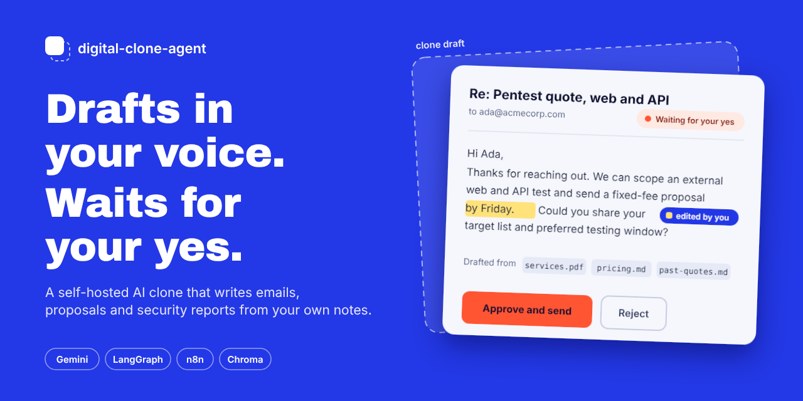

<p align="center"></p>

# digital-clone-agent

**Your AI clone for work.** Upload your CV, projects and past replies once. It then drafts emails, proposals, meeting briefs, vulnerability-report triage, pentest write-ups and social posts in your voice, learns from what you approve, and never sends anything on its own.

One container, one web page, one command. Powered by Gemini. Self-hosted: your notes stay on your machine.

## Quick start

```bash
git clone https://github.com/<you>/digital-clone-agent && cd digital-clone-agent
./setup.sh          # creates secrets, asks for your Gemini key, starts everything
```

Open http://localhost:8000, paste the unlock key it prints, then:
1. **Persona**: say who you are and how you write.
2. **Knowledge**: drag in your CV, project write-ups, pricing, good past replies (.pdf .md .txt .csv .json).
3. **Skills**: pick one, fill the form, get a draft. Hit **Good** to teach it your style, or **Copy**.

No Docker? `cd agent && pip install -r requirements.txt` and run `uvicorn app.main:app` with the env vars from `.env.example`.

## What you get

| Tab | What it does |
|---|---|
| Skills | 7 built in: email reply, proposal, meeting brief, bug-report triage, pentest finding write-up, social post, follow-up |
| Chat | Ask your clone about your own work; answers cite which files they used |
| Knowledge | Upload, list, delete what it knows |
| Persona | Edit your voice and rules in the browser |
| Approvals | Email drafts waiting for you (with the Gmail automation) |
| History | Audit log of every draft and what you did with it |

**It learns.** Every draft you accept or edit is stored and used as a style example for that skill next time. No fine-tuning, no setup.

## Add your own skill (no code)

Drop a YAML file in `skills/`. It appears in the UI immediately.

```yaml
name: invoice_chaser
title: Invoice chaser
description: Polite payment reminder.
inputs:
  - {name: client, label: Client, type: text}
  - {name: details, label: Invoice details, type: textarea}
untrusted: [details]
retrieve_from: [details]
prompt: |
  Write a polite payment reminder to {{client}}. Details: {{details}}
```
See `skills/README.md`.

## Optional: Gmail automation

```bash
docker compose --profile automation up -d      # adds n8n at http://localhost:5678
```
Set `SEND_WEBHOOK_URL=http://n8n:5678/webhook/send-reply` in `.env`, restart, then in n8n import `n8n/1-email-triage.json` and `n8n/2-send-approved-reply.json`, attach Gmail OAuth, and add two Header Auth credentials (`X-API-Key` = your `API_KEY` for the HTTP node, `X-Webhook-Secret` = your `SEND_WEBHOOK_SECRET` for the webhook node). New emails are classified, drafted, and wait in **Approvals**; approving sends through n8n. n8n parameters shift between versions, so re-select anything it flags.

## Security model

- The agent has no mailbox credentials and no action tools. Only n8n can send, and only after you approve.
- Outside text (emails, reports) is wrapped as untrusted data to resist prompt injection. Worst case is a bad draft.
- Deny-by-default API key, localhost-only ports, non-root container, strict CSP on the UI, upload size and type limits.
- Run history stores inputs and drafts in a local SQLite file under the `agent_data` volume. Treat that volume as sensitive.
- Don't upload credentials or unredacted client data. If you expose this beyond localhost, use HTTPS and a reverse proxy.

## Architecture

```
Browser UI ──► FastAPI ──► skills (YAML) ─┬─► Gemini (draft)
                  │                       └─► Chroma: your notes + approved examples
                  └─► LangGraph email flow (classify → retrieve → draft → PAUSE for approval, SQLite checkpoints)
n8n (optional) ◄──► Gmail
```

## Configuration

`CHAT_MODEL` (default `gemini-2.5-flash`) and `EMBED_MODEL` (default `gemini-embedding-001`) are env vars; use whichever Gemini models are current. Other providers can be added behind `agent/app/llm.py`.

## Development

```bash
cd agent && pip install -r requirements.txt -r requirements-dev.txt && pytest
```
Tests mock the LLM, so no API key is needed. See [CONTRIBUTING.md](CONTRIBUTING.md) and [SECURITY.md](SECURITY.md).

## Roadmap

Scheduled daily briefs, Telegram/Slack approvals, calendar prep, more providers, multi-agent crews for larger teams.

## Disclaimer

Drafts are LLM output. Review before sending. You are responsible for what you send and for the privacy of what you ingest.

MIT licensed.
